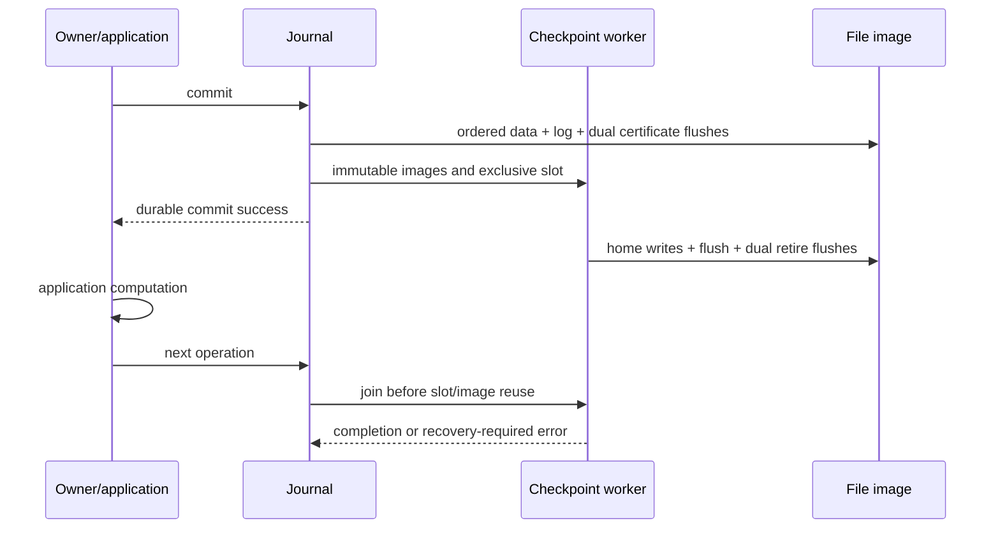

# Checkpoint scheduling and ownership

The current log has one transaction slot. Independent concurrent log writers
would overwrite recovery state, so it cannot provide overlapping commits without
a multi-slot format and block-version lifetime tracking. A queued application
operation is not evidence of parallel NVMe I/O.

For the file backend, optional background checkpointing returns a successful
commit only after ordered data, descriptors, payload and both commit certificates
have been flushed. One worker then checkpoints the immutable staged images,
flushes home data, retires both controls and releases the images. The next journal
operation joins that worker before changing staging state. Thus application work
between calls can overlap checkpoint I/O; the following filesystem operation may
wait. Protected home blocks cannot be reused before retirement.

A worker error after a successful commit is a post-commit checkpoint failure:
future operations report EIO and require reopen/replay. It never turns the earlier
accepted group into an aborted group. Close joins the worker before releasing the
backend. Failure to create a worker falls back to synchronous checkpointing.

The standalone public handle still has one owner thread; callers must not invoke
filesystem APIs concurrently. The background worker invokes checkpoint hooks, so
hooks installed with asynchronous mode enabled must tolerate that thread. Stats,
status and subsequent operations synchronize with the worker before reading
mutable journal state.

SPDK transport currently owns one thread-affine qpair and a shared DMA buffer.
Background checkpoint mode is rejected for it. A proper multi-queue extension
requires per-queue DMA/request ownership, explicit completion lifetimes, serial
metadata publication and shutdown drain. The supported filesystem cache-bypass
API below integrates cache invalidation and the DATA-TX overlay. Historical AIO
prepare helpers and physical parallel SPDK execution remain unsupported.

## Multi-thread submission and group commit

`nvfuse_queue_create` binds a bounded queue to the existing owner thread. Producers
submit asynchronous read/write futures; the owner calls `nvfuse_queue_poll` and
executes the admitted batch in FIFO order. Depth is limited to 128. Mode 0 commits
each request, mode 1 commits the batch as metadata, and mode 2 protects its data
as well. All batch futures become ready only after commit. A failed grouped
operation aborts the entire batch and returns its error to every member. DATA
mode restores protected bytes; metadata mode retains its ordinary data contract.

Pre-existing descriptors are included in the internal group snapshot. This is
an internal queue mechanism; public user TX begin still requires no open files
and is rejected while queues exist. File close returns EBUSY until all queues
are destroyed. Stop cancels queued work, rejects new submission, and lets the
owner finish an already admitted batch. Producers retain buffers until consuming
one future wait. Join producers before destroying the queue; completed futures
remain waitable after destruction. Descriptor close/reuse must wait for its jobs
to drain. Cross-queue order follows owner polling; no fairness guarantee is made.

`nvfuse_pread_direct` and `nvfuse_pwrite_direct` bypass the filesystem data cache,
with 4 KiB buffer/offset/count alignment. They drain pending buffered writes,
consult the same journal overlay and invalidate stale data-cache entries before
direct writes. They do not promise host-page-cache O_DIRECT behavior. The queue
has explicit direct and buffered operation codes. Historical AIO prepare helpers
remain unsupported on journal mounts because they lack these completion and
buffer-lifetime contracts.

Hooks must not reenter the same journal or filesystem handle. Background mode
requires thread-safe hooks and callbacks. Queue submission is multi-threaded;
filesystem execution and the current SPDK qpair remain serialized by the owner.
