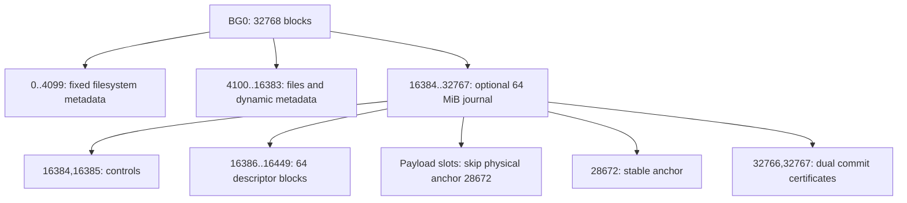

# Larger DATA groups and journal geometry

Version 2 keeps the discovery anchor at physical block 28672. The anchor records
the complete reserved extent in BG0. New file images can choose 16, 32 or 64 MiB
with `nvfuse_file_open_config`; default callers still create 16 MiB journals.
Existing images are discovered without resizing. Version 1 accepts only its
original 16 MiB extent. Unknown geometries and versions fail before mount.

| Journal | Reserved BG0 blocks | Descriptor blocks | Protected image capacity |
| --- | --- | --- | --- |
| 16 MiB | 28672..32767 | 16 | 4075 |
| 32 MiB | 24576..32767 | 32 | 8155 |
| 64 MiB | 16384..32767 | 64 | 16315 |

Logical journal slot 0 always denotes the stable anchor. Slots 1 onward enumerate
the reserved physical extent, skipping the anchor block. This exactly reproduces
the old mapping for the default extent and prevents a large payload from
clobbering discovery state. Controls occupy slots 1 and 2; descriptors start at 3,
then payload; the final two slots hold the commit certificates. The descriptor
count is the minimum satisfying `128 + 16 * capacity <= 4096 * descriptors`, with
`capacity = journal_blocks - descriptors - 5`.

A 24 MiB overwrite plus metadata now fits in one DATA group with a 64 MiB
journal. No protected home write precedes its durable certificates. The group
still has a finite distinct-block budget; it is never split into early commits.
The formatter subtracts the entire selected extent from both allocation bitmap
and free counters. The independent checker discovers that extent from disk.

## Resource admission

Staging images and indexes are reserved when the journal opens. The staging hash
is sparse rather than indexed by every volume block. Fixed metadata classification
is computed from block-group position; dynamic classification is an append-only
sparse set. Classification allocation is preflighted at public API boundaries.
When a group approaches capacity, a bounded overflow workspace and its hash are
also reserved before core locks are acquired. Overflow images are abort-only.

A write whose payload alone cannot fit its selected DATA budget fails before
changing mappings. Other operations may discover hidden metadata costs and
become abort-only. A pending large truncate followed by growth/write in the same
user group returns E2BIG if completing its pending suffix would exceed 256 logical
blocks; commit the truncate separately or abort. Cleanup after commit is bounded
and resumable. This limit prevents a seemingly small write from triggering an
unbounded synchronous truncate inside the user group.

These checks are not a proof of complete resource admission for every legacy
B+tree/cache/mount path. Some legacy cache I/O and allocation failures still abort.
Supported recoverable journal allocation and direct-payload I/O paths are tested
separately; arbitrary ENOMEM throughout the original filesystem is not qualified.

## COW evaluation

COW is not implemented in this change. Merely putting a new inode pointer in the
journal is insufficient: an old data block freed inside the transaction must not
be reallocated and overwritten before commit, or abort would lose committed data.
A correct COW option needs a persistent allocation/retirement lifetime, an
allocator quarantine, coherent cached versions, and crash-safe reclamation of
unpublished allocations. The current single-slot journal cannot substitute for
that lifetime protocol. Configurable full-data redo provides a bounded, testable
increase without claiming unlimited streaming transactions or a COW mode.
