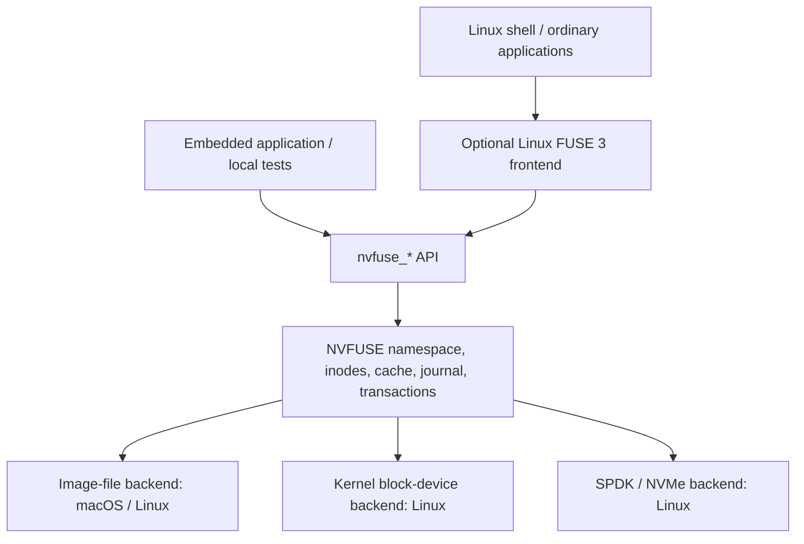

# Optional Linux FUSE 3 Frontend

Date: 2026-11-12

Status: Implemented optional Linux frontend for image files, kernel block
devices and SPDK NVMe. See the [backend matrix](backend-matrix.md) for the
primary API/SPDK performance path and compatibility build boundaries.

## Architecture and scope

The NVFUSE core remains shared. The frontend determines how applications reach
the filesystem; the storage backend determines where its blocks are stored.



| Configuration | Access | Storage | Build |
| --- | --- | --- | --- |
| Native local development | Direct library API | Image file | Existing `make local` and local test targets |
| SPDK development | Direct library API | SPDK NVMe | Existing SPDK build and integration targets |
| Kernel block-device access | Direct API or Linux FUSE 3 | Linux block node | Standalone library or `make fuse` |
| Linux mounted development | Kernel FUSE API through libfuse 3 | Image file | Optional `make fuse` |
| Linux mounted NVMe access | Kernel FUSE API through libfuse 3 | SPDK NVMe | Optional `make fuse-spdk` |

The first mounted configuration runs entirely inside the QEMU Linux guest. It
does not require a macOS filesystem extension. Native macOS mounting is outside
this implementation. FUSE-to-SPDK mounting is available as a separate
compatibility build and has been tested on the dedicated QEMU NVMe fixture. It uses the synchronous
standalone transport; the original performance reactor remains separate.

The adapter is [`examples/fuse3/nvfuse_fuse.c`](../examples/fuse3/nvfuse_fuse.c).
It translates requests to existing NVFUSE APIs and selects storage through
[`nvfuse_backend.h`](../include/nvfuse_backend.h). The original
[`nvfuse_file.h`](../include/nvfuse_file.h) image API remains available.
Storage I/O, journal publication,
recovery, transaction boundaries, and the on-disk layout are not replaced.
Shared API fixes cover stat/fstat/readlink, Linux metadata setters, initialized
statvfs fields, and binary-safe inline xattrs. Existing string xattr entry points
retain their NUL-terminated read-buffer convention.

## Setup and commands

Use the existing dedicated QEMU VM described in the [README](../README.md).
The VM must have `/dev/fuse` available. Inside its Rocky Linux guest:

```sh
sudo dnf install fuse3 fuse3-devel pkgconf-pkg-config clang make python3
make fuse
make fuse-adapter-test
make fuse-test
```

`Makefile.fuse` uses `pkg-config fuse3` and builds into `build/fuse`, with a
separate 1024-entry open-file table. Local and SPDK builds keep their defaults
and require no FUSE headers or libraries. The old `examples/libfuse` FUSE 2/SPDK
example remains a separate legacy example.

From the Mac checkout, build and test through the VM's pinned-key SSH helper:

```sh
python3 scripts/test-fuse-qemu.py
# Optional callback memory/undefined-behavior checks inside the guest:
python3 scripts/test-fuse-qemu.py --sanitize
```

The runner can start the existing VM if it is stopped. It uploads source into
`~/src/nvfuse-fuse-dev`, runs FUSE tests there, and copies reports into the host
`build/test-results/fuse-qemu-*` directory. It never formats the QEMU NVMe fixture;
these tests use newly created ordinary image files. Package installation is an
explicit setup step, not an action performed by the test runner.

For an interactive mount, run these commands inside the guest checkout:

```sh
mkdir -p build/fuse/mount
./build/fuse/nvfuse-fuse --mkfs build/fuse/dev.img --size-mib 256
./build/fuse/nvfuse-fuse --image build/fuse/dev.img build/fuse/mount
```

The mount process stays in the foreground. In another guest shell:

```sh
printf 'hello from Linux\n' > build/fuse/mount/hello.txt
cat build/fuse/mount/hello.txt
ls -la build/fuse/mount
fusermount3 -u build/fuse/mount
```

Use `--debug` for FUSE request diagnostics. Mounting opens an existing image and
never formats it. Creation refuses an existing path and requires a size that is
a multiple of 128 MiB. The backing image must be outside the mount point. Use
normal data-preserving images, not metadata-only test images. New images receive
the invoking UID/GID and a searchable root directory with mode 0755. Mounting
does not rewrite the ownership or permissions of existing images.

## Request handling and semantics

The frontend runs with `-f -s`: backend open, all operations, and close execute on
one owning thread. This preserves the current core ownership contract. A mutex
around arbitrary FUSE worker threads would not satisfy it. The image backend
retains its exclusive lock, so direct API tests and another mount must use a
different image. FUSE-private handles contain NVFUSE identifiers, never host file
descriptors. Descriptor access modes come from the stored open state because
FUSE does not populate open flags in every callback.

Implemented callbacks cover attributes, directory enumeration, create/open,
buffered read/write, flush/release/fsync, mkdir/rmdir, unlink, rename, hard links,
symlinks/readlink, chmod/chown/timestamps, truncate, statfs, and xattrs. Directory
pagination preserves continuation offsets and skips unused slots. Permissions
use `default_permissions`; `allow_other` and ACL support are not enabled.

The high-level libfuse API uses its standard `.fuse_hidden*` name handling for
deleted or replaced open files. This allows subsequent descriptor operations
including fstat and ftruncate to work even when a kernel attribute request has
no file handle. The hidden entry is removed on final close. Consequently, link
counts and directory visibility while such files remain open can differ from
native unlink semantics; a process crash with open hidden entries can leave
named hidden files. The mounted recovery test closes all workload descriptors
before killing the frontend. Core version-2 orphan semantics are independently
exercised by direct callback/core tests. A future inode-based low-level FUSE
frontend would be needed for stronger mounted unlink semantics.

Normal public operations keep their existing internal transaction boundaries.
Several shell commands are not implicitly grouped into an application transaction.
The explicit TX API remains available to embedded applications. Fsync failures
are propagated; recovery-required handles must be closed/reopened according to
the existing core contract. Unmount closes remaining descriptors and the backend
on the owner thread and reports cleanup failures.

Binary xattrs support get/set/list/remove, size queries, empty values, and
create/replace flags. All attributes share the inode's 3972-byte inline area.
Oversized values/full storage fail explicitly. The existing record geometry is
unchanged, but older string-only readers may reject binary values.

## Compatibility limits

Known limits include 115-byte filename components, 16-bit UID/GID, timestamps at
second resolution, no accurate allocated-sector count in stat (`st_blocks=0`),
no ACL/advisory-lock implementation, no rename exchange/no-replace flags, and
no pinning of removed open directories. Metadata changes through a pathless
descriptor can return `EOPNOTSUPP`. Filename normalization follows the existing
core. This is tested basic POSIX behavior, not complete POSIX conformance.

The optional frontend does not establish an NVMe performance claim. Continue to
use direct local, transaction/recovery, and SPDK tests for their respective
contracts.
