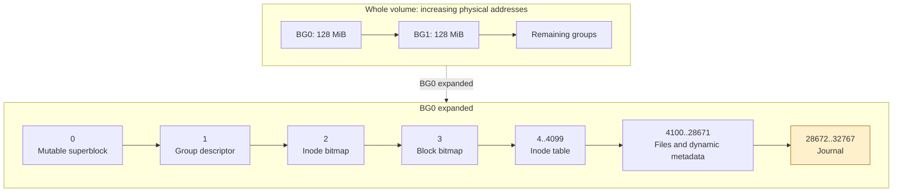
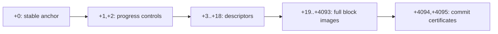
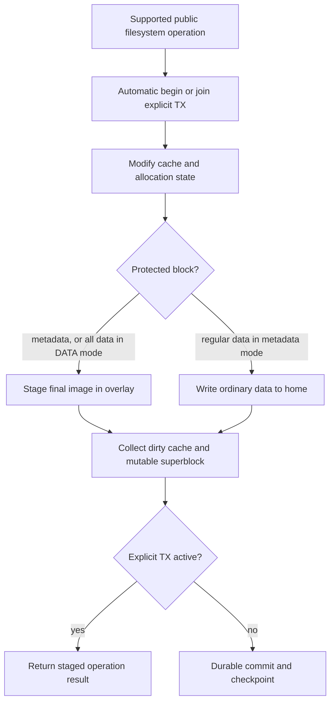
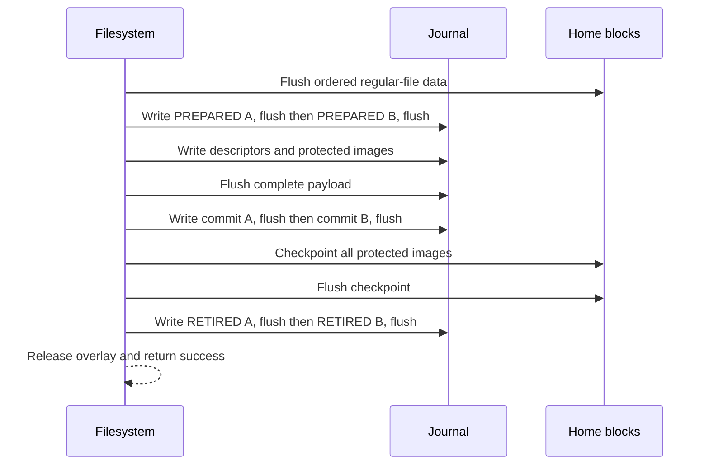
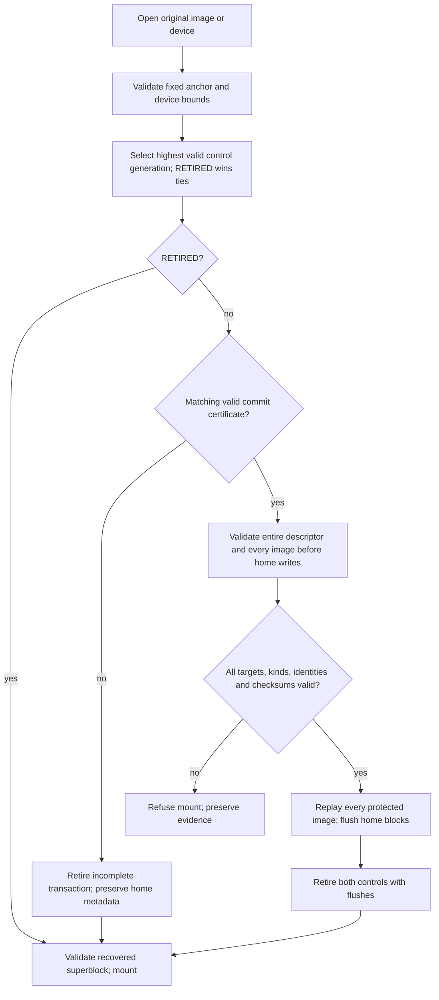

# NVFUSE Metadata Journaling

Date: 2026-11-12

Status: Synchronous reference implementation for the standalone file and SPDK/NVMe backends. See [validation and measurements](journaling-evaluation.md) for tested behavior and remaining limits.

## Purpose and boundaries

The filesystem automatically protects its own metadata. Applications do not need a transaction API to recover a supported filesystem operation after an abrupt shutdown. The optional [user TX API](user-transactions-design.md) groups several operations and can additionally protect regular-file contents.

The implementation uses full-block physical redo, one writer and one outstanding transaction, with synchronous checkpointing. Uncommitted metadata stays in an in-memory overlay. A durable commit authorizes replay; checkpointing copies protected images to their home addresses. A home address is the normal block location outside the journal.

Ordinary buffered operations use automatic metadata transactions. Existing regular-file overwrites can survive an aborted metadata transaction. DATA mode adds those bytes to the protected set. This distinction is independent of the requirement to preserve allocation and namespace consistency.

## Whole disk layout

Each block is 4 KiB; each group is 128 MiB. New standalone images reserve a filesystem-wide 16 MiB journal at the end of BG0. The formatter marks every journal block allocated and subtracts it from group and global free counts. Other group boundaries and fixed metadata offsets are unchanged.

Directory data, directory indexes, indirect blocks and symlink targets are metadata even though they occupy the data area. Fixed metadata blocks 0..4099 of each group are classified at mount; dynamically accessed metadata blocks are classified by the buffer-cache path. Classification is retained for the mount lifetime. Reused blocks may consequently receive extra logging, which is conservative.

Unlike the original proposal, **block 0 remains mutable** and is journaled. The stable discovery anchor is at physical block 28672, a fixed address independent of mutable superblock bytes. NVMe reopening obtains volume size from that anchor before replay, bounded by the actual device size. Reserved superblock slots in other groups are not implemented recovery backups.

## Format and journal layout

New normal images use signature `0x4a46564e`; the test-only format that discards regular payload uses `0x4a4d564e`. Legacy clean images retain their old signatures and do not gain historical recovery. Older binaries reject the new signatures. There is no in-place conversion tool.

The journal ABI uses explicit little-endian integers and CRC32C. Existing filesystem home structures retain their legacy native ABI; this does not establish cross-platform image interchange.

All offsets in this figure are relative to journal start. The extent is fixed at 4096 blocks. The maximum protected payload is **4075 distinct blocks**, including metadata, or 16,691,200 bytes. File-data capacity is smaller because metadata consumes slots too.

| Structure | Fields and validation |
| --- | --- |
| Stable anchor | Magic, version 1, test-format flag, volume byte size, random 128-bit UUID, journal extent, CRC32C |
| Progress control, two copies | Magic, transaction ID, UUID, PREPARED or RETIRED, CRC32C |
| Descriptor area, fixed 16 blocks | Magic, transaction ID, UUID, image count, DATA-mode flag; 16-byte entries with home block, metadata/data kind, payload CRC32C |
| Payload | Complete final 4 KiB images, one per distinct home block |
| Commit certificate, two copies | Magic, transaction ID, UUID, image count, CRC32C of the entire descriptor area, DATA-mode flag, certificate CRC32C |

The anchor is published and flushed last during formatting. UUID binding rejects stale records from previous formats. Transaction IDs increase without wraparound. Both control copies must be retired before a later transaction can overwrite the shared payload area.

The fixed descriptor area and bitwise CRC32C prioritize a small reference implementation; they have measurable overhead on small transactions. A compact descriptor format or accelerated checksum requires further validation.

## Runtime and persistence ordering

The public operation wrapper begins an automatic transaction, invokes nested implementation helpers, collects dirty buffers and the superblock, then commits. Inside an explicit user TX, the same wrapper collects images without publishing a commit. Internal flushes cannot commit the user group.

Reads consult the overlay after cache eviction. Repeated writes replace a staged image. Full-block images identical to home bytes need no payload slot. Large buffered writes drain bounded chunks outside the legacy cache lock while retaining the same transaction boundary.

A nonempty commit performs nine flushes. An empty protected set still flushes ordinary data, so `fsync` cannot silently skip a data-only overwrite. All persistence claims depend on the backend honoring its flush contract. On a regular host file, `fsync` tests the host filesystem boundary; it is not evidence of a physical SSD power-loss guarantee.

Two independently flushed commit certificates reduce sensitivity to a torn overwrite during commit publication. Either valid certificate for the selected prepared generation authorizes replay. Conflicting valid certificates are rejected. Checkpoint begins only after both publication flushes succeed.

## Recovery

Recovery runs before the legacy core mounts or consumes mutable allocation state. After recovery, the backend presents the recovered mounted state as clean to the legacy mount path, then journals the new mount state.

Targets must be within the volume and outside the journal; duplicate destinations and invalid coverage kinds are rejected. Replay checks every image before writing any home image. A crash during replay leaves the committed log available for idempotent replay. A retired control is authoritative only after checkpoint durability, so partial retirement safely suppresses later redundant replay.

CRC32C detects corruption; it is not authentication. There is one stable anchor, no repair fallback for arbitrary anchor loss, and no claim of recovery from arbitrary corruption of both commit copies after checkpoint has started. Recovery is not an offline fsck, and does not repair pre-journal damage or validate every dynamic block's semantic ownership.

## Failure handling and support limits

The initial implementation supports one filesystem handle, one owning thread, synchronous buffered APIs and no nested explicit TX. Direct/AIO paths, xattrs and fallocate are rejected on journal mounts. Unlink of the last link to an open file, and rename replacement of such a target, return `-EBUSY` until orphan tracking exists. Sparse writes past EOF and truncate growth are rejected; sequential extension and shrinking are supported. The test-only payload-discard format cannot provide DATA transactions.

A failed explicit operation makes the TX abort-only. Budget overflow returns `-E2BIG` at the public boundary and requires abort. The journal preserves overflow images in memory long enough to finish the current legacy operation coherently; such images cannot be committed. This is bounded on-disk capacity, not strict bounded RAM admission. Exact operation-credit reservation remains future work. The staging index also costs approximately 4.125 bytes per volume block, in addition to the initial 16 MiB image buffer; very large volumes require a sparse index before this is practical.

Abort discards caches and remounts the committed image. A failed automatic operation uses the same rollback path. Metadata mode cannot undo ordinary data overwrites. O_SYNC uses the outer boundary; inside an explicit group it does not publish an independent commit. Explicit `sync`, `fsync` and `fdatasync` return `-EBUSY` while the group is active.

An I/O/flush failure during journal publication or checkpoint marks the handle RECOVERY_REQUIRED and rejects subsequent operations. Close can discard volatile caches and release an already failed handle, returning `-EIO`; reopen resolves the durable log. Legacy cache I/O failures and some legacy allocation/partial-mount failures still terminate the process because those core paths cannot unwind safely. This reference version does not promise complete recoverable errno behavior under all ENOSPC/ENOMEM conditions.

The original multiprocess bdev/event reactor is outside this implementation. Its journal-format mounts must not bypass signature validation. There is no orphan/deferred-delete format, concurrent group commit, background checkpointing, online resizing or persistent outcome-query API.

## ext4, XFS and NVFUSE

These filesystems all depend on write-ahead ordering and persistent commit/recovery state. Their journals are not interchangeable formats.

| Property | ext4 | XFS | NVFUSE reference implementation |
| --- | --- | --- | --- |
| Log location | Usually an internal journal inode; external journal supported | Internal log extent or external log device | Fixed 16 MiB extent in BG0 |
| Main representation | JBD2 descriptor and full-block metadata images, commit and revoke records | Typed metadata log items, regions and intent/done mechanisms | Full 4 KiB metadata images; optional regular data images |
| Ordinary file data | Commonly ordered mode; writeback and data-journal modes available | Regular data is not ordinarily journaled | Ordered regular writes; optional DATA user TX |
| Space reuse | Circular journal, sequence and revoke handling | Circular log, LSN/cycle and tail tracking | One reusable slot; synchronous checkpoint and dual retirement |
| Throughput machinery | Concurrent transactions, batching, asynchronous checkpoint | Delayed logging, CIL aggregation, scalable allocation groups | Single writer, synchronous checkpoint, explicit application batching |
| Recovery | Established JBD2 replay/revoke semantics | Established typed replay and deferred-operation recovery | Checksum-validated physical image replay |
| Arbitrary application multi-operation TX API | Not provided by ordinary POSIX interfaces | Not provided by ordinary POSIX interfaces | Explicit begin/commit/abort on the supported embedded handle |
| Maturity | Broad production deployment | Broad production deployment | New reference implementation with limited coverage |

NVFUSE has **no demonstrated advantage in metadata recovery robustness or general filesystem throughput over ext4/XFS**. Its concrete application benefit is an embedded transaction boundary that can atomically publish several filesystem operations and optionally their file bytes. Batching reduces this implementation's repeated journal overhead; measured results are in the evaluation report. That benefit is separate from the mandatory automatic metadata protection and is not a direct ext4/XFS speed comparison.

For authoritative format and architecture details, see the Linux kernel documentation for [ext4 journal/JBD2](https://docs.kernel.org/filesystems/ext4/journal.html), [XFS logging](https://docs.kernel.org/filesystems/xfs/xfs-logging.html), and [XFS delayed logging](https://docs.kernel.org/filesystems/xfs/xfs-delayed-logging-design.html).

## Source and validation

- [Journal engine and recovery](../nvfuse_journal.c), [disk constants and backend API](../include/nvfuse_journal.h).
- [Backend, format and mount ordering](../nvfuse_file.c), [cache metadata classification](../nvfuse_buffer_cache.c).
- [Automatic/user transaction boundaries](../nvfuse_tx.c), [public API wrappers](../nvfuse_tx_wrappers.c).
- [Independent persistence model](../tests/journal_engine_test.c), [filesystem TX oracle](../tests/transaction_test.c), [crash runner](../tests/run_transactions.py).
- [Measurements and remaining validation gaps](journaling-evaluation.md).
