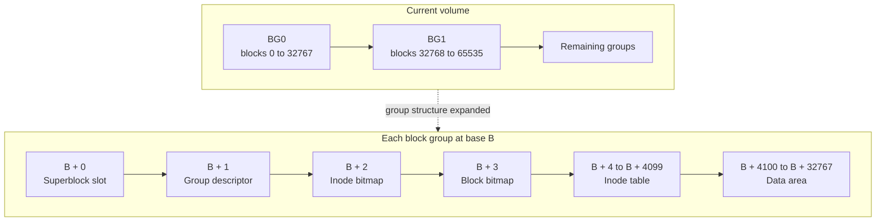
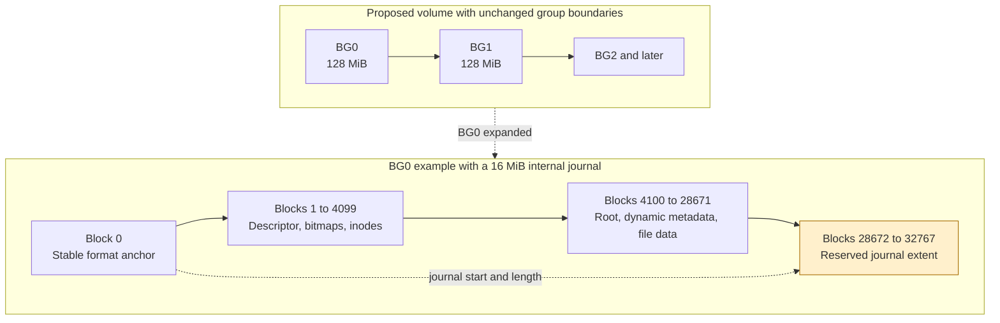
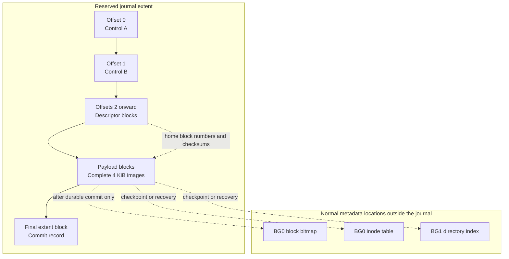
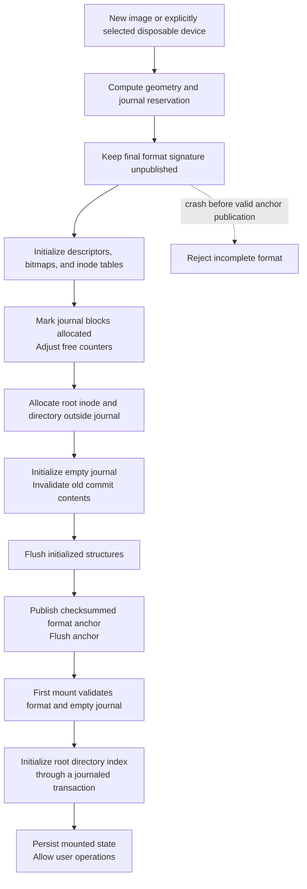
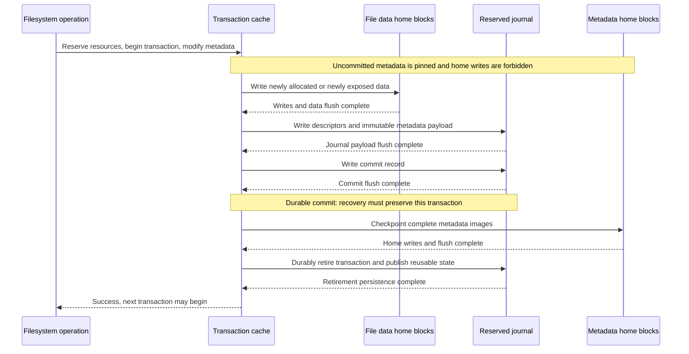
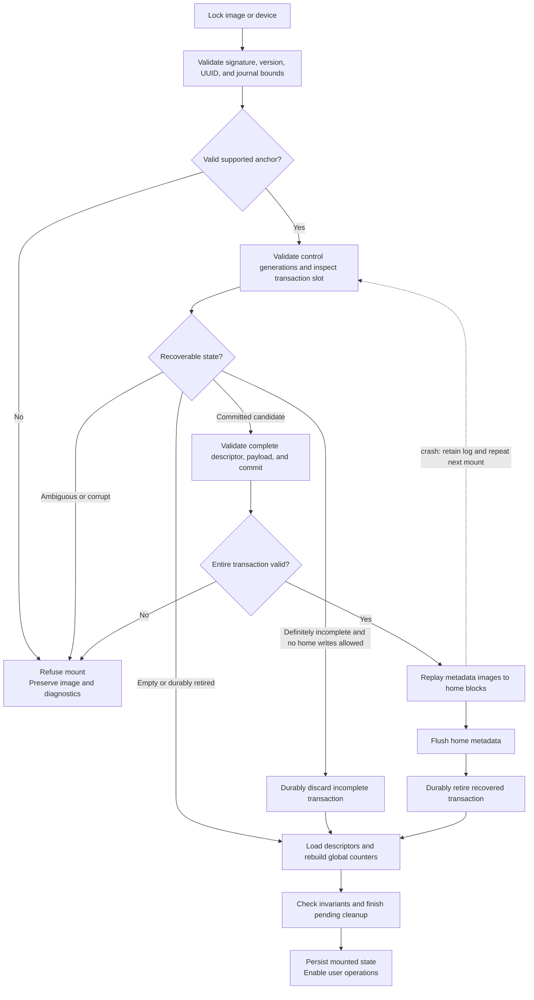
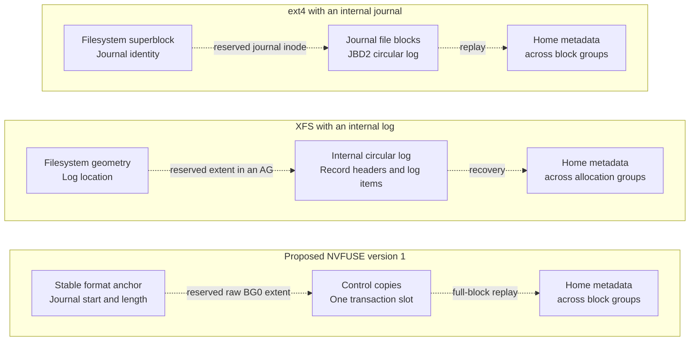
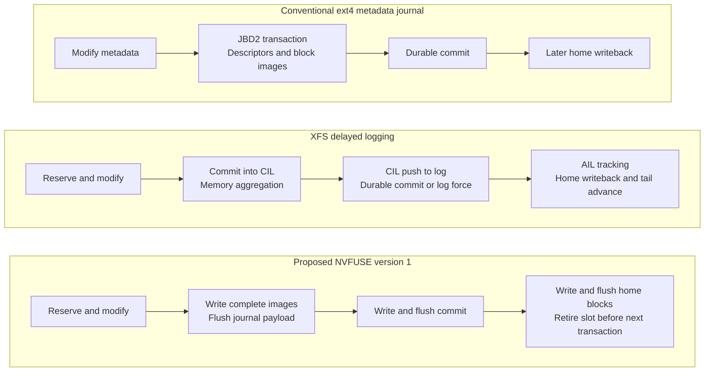

# NVFUSE Metadata Journaling Design

Date: 2026-11-12

Status: Design proposal before implementation

NVFUSE needs metadata journaling to reopen the same filesystem after an abrupt shutdown without reformatting it. The current implementation detects an unclean state and refuses to mount; it does not recover partially persisted metadata updates.

The proposed first version uses **physical redo logging of complete metadata blocks, one transaction at a time, with synchronous checkpointing**. It writes metadata images to a reserved journal, makes the commit durable, and then copies those images to their normal locations. Transaction boundaries, cache writeback, error handling, sync APIs, and mount ordering must all enforce this protocol.

All NVFUSE journal structures, addresses, state transitions, and diagrams below describe a proposal. They are not implemented. ext4 and XFS describe existing designs; NVFUSE refers to this repository.

## Goals and Scope

After recovery, directory entries, inodes, allocation bitmaps, directory indexes, and free-space accounting must agree. A committed metadata transaction must survive recovery. An uncommitted transaction must not leave partial changes in home metadata blocks. A home block is the normal filesystem location of a block, outside the journal.

- Namespace operations such as rename recover to their previous or completed state.
- Recovery prevents double allocation, references to freed blocks, and leaks caused by interrupted metadata operations.
- Successful `fsync()` and `sync()` include durable data and metadata commits within their defined scope.
- Recovery can restart after another crash without changing its result.

Metadata journaling does not make overwrites of existing regular-file data atomic. Newly allocated or newly exposed data must be initialized and persisted before the corresponding metadata commit. Existing images damaged before journaling was introduced require a separate checker or repair tool; there is no historical log to replay.

Initial support covers the local file backend and the newer standalone SPDK transport using the same core. Journal-format write mounts through the legacy multiprocess bdev/event reactor must be rejected until journal ownership and cross-process transaction coordination exist. Unsupported direct or asynchronous I/O paths must also be rejected rather than bypassing the protocol.

## Current Implementation

Source links refer to the code reviewed for this proposal.

| Area | Current behavior | Required change |
| --- | --- | --- |
| Core mount | [nvfuse_mount](../nvfuse_core.c#L1384) converts persisted `MOUNTED` to `CRASHED` and fails. `CRASHED` is also rejected. | Evaluate and replay the journal before applying the final mount-state decision. |
| Backend validation | [mount_target](../nvfuse_file.c#L159) accepts only `FORMATTED` and `UMOUNTED`. | Admit recoverable journal-format images into the recovery path. |
| Writeback | [nvfuse_sync_dirty_data](../nvfuse_core.c#L957) writes dirty blocks directly to home addresses. [nvfuse_flush_dirty_data](../nvfuse_core.c#L2857) flushes after writing batches. | Prevent uncommitted metadata from reaching home addresses. |
| Namespace changes | [nvfuse_rename](../nvfuse_api.c#L1880) removes the old name, handles the destination, and links the new name sequentially. | Keep nested operations inside one transaction. |
| Cache pressure | [nvfuse_replace_buffer_cache](../nvfuse_buffer_cache.c#L106) can force a flush during an operation. | Reserve resources and pin uncommitted metadata. |
| Metadata identity | META is tracked in a temporary [buffer head](../include/nvfuse_buffer_cache.h#L74), which the default [release path](../nvfuse_buffer_cache.c#L940) frees. | Preserve type and transaction ownership in the buffer cache. |
| File sync | [nvfuse_fsync](../nvfuse_api.c#L2563) uses inode dirty lists, but [the configuration](../include/nvfuse_config.h#L186) disables their tracking. The internal writeback path also contains `assert(0)`. | Connect dirty-cache submission, commit completion, and error reporting. |
| Superblock persistence | [nvfuse_sync_superblock](../nvfuse_core.c#L1293) writes directly, outside the dirty cache. | Separate stable format discovery from mutable filesystem state. |

When inode dirty counts are zero, the current `fsync()` path can reach device flush without submitting that file's dirty cache blocks. A device flush cannot persist writes that have not been submitted. Clean-unmount tests therefore do not establish crash durability.

The opening NVMe metadata durability claim in [README](../README.md) should be reconciled with the implemented guarantees. The reviewed transport uses ordinary read, write, and flush commands; these do not provide atomicity across a filesystem metadata transaction.

## Disk Layout

### Current Layout

The formatter computes 128 MiB block groups with 4 KiB clusters. With the current 4 KiB inode size, each group has 32,768 blocks and a 4,096-block inode table. These values follow [the layout definitions](../include/nvfuse_core.h#L313) and [nvfuse_make_bg_descriptor](../nvfuse_mkfs.c#L163), rather than the separate legacy `NVFUSE_BG_SIZE_BITS` macro.

**Figure 1. Current filesystem and block group layout.** Arrows show increasing physical block addresses. The superblock at physical block 0 is inside BG0, not an extra block preceding the groups.

The formatter reserves a superblock slot in each group, but writes the primary filesystem superblock at block 0. Reserved slots are not an implemented backup-superblock recovery mechanism. The data area contains regular-file data as well as directory blocks, B+tree nodes, indirect blocks, and other dynamically allocated metadata.

### Proposed Internal Journal Placement

Reserve a contiguous extent at the **end of BG0's data area**, preserving existing group boundaries and fixed metadata offsets. Allocate this extent during mkfs, mark it unavailable in BG0's block bitmap, and subtract it from group and global free-space accounting. It is one filesystem-wide journal, not one journal per group.

**Figure 2. Proposed placement within the whole volume.** The 16 MiB size is an illustrative development configuration, not a selected default or a transaction-size guarantee.

| Example geometry | Value |
| --- | --- |
| Cluster size | 4,096 bytes |
| Blocks per group | 32,768 |
| BG0 fixed metadata | Blocks 0 through 4,099 |
| BG0 original data area | Blocks 4,100 through 32,767 |
| Example journal length | 4,096 blocks = 16 MiB |
| Example journal start | Block 28,672 = byte offset 112 MiB |
| Example journal end | Block 32,767, inclusive |
| BG0 data-area capacity before root and other allocations | 24,572 blocks after journal reservation |

For a journal length `J` in blocks, this placement uses `journal_start = 32768 - J`. Mkfs must check that the extent does not overlap fixed metadata, root allocations, or other reservations. Every allocator, including contiguous allocation, must respect the reserved bits. Space remains consumed even when the journal is empty.

The journal is a raw reserved extent discovered from format metadata; it is not a user-visible file and has no file block mapping to traverse during recovery. An external journal device is outside the initial scope.

### Stable Format Discovery and Mutable State

For the new format, make block 0 a stable runtime anchor holding the signature, version, UUID, geometry, root inode, and journal location. Do not rewrite the journal locator whenever counters or mount state change. This is a proposed change to the current superblock semantics.

Keep mount and journal progress in checksummed journal control records. Recover global allocation counters from journal-protected group descriptors at mount; persistent per-group counters and their bitmaps must be updated together. If persistent global counters are retained instead, place them in a separate journaled home block. That alternative requires a reserved address in the final ABI.

A runtime-immutable anchor avoids torn ordinary state updates destroying journal discovery. It does not repair arbitrary corruption of the anchor. Redundant format anchors and their fixed discovery rules remain a format decision; a mount that cannot validate its locator must refuse recovery writes.

## Journal Record Format

**Figure 3. Proposed journal extent and metadata copies.** All offsets are relative to `journal_start`. The transaction slot is reused only after durable retirement of its previous contents.

| Record | Proposed contents |
| --- | --- |
| Format anchor | Distinct signature, format version, incompatible features, volume UUID, geometry, journal start and length, checksum |
| Control A and B | Record generation, volume UUID, active transaction ID, progress state, last retired transaction, checksum |
| Descriptor | Transaction ID, entry count, metadata type, each home block number, payload offset and checksum |
| Payload | Complete post-update metadata block images, deduplicated by physical home block |
| Commit | Volume UUID, transaction ID, descriptor and payload digest, lengths, checksum |

The example fixes the commit at the last journal block so it can be inspected without trusting a torn descriptor. Unused space between the payload and commit remains reserved. The field encoding, byte order, checksum algorithm, control publication protocol, and final offsets must be fixed before implementation. Existing in-memory C structs are not the on-disk ABI.

For `J` reserved blocks, `D` descriptor blocks, and `N` payload blocks, the pictured layout requires `2 + D + N + 1 <= J`. Descriptor capacity and worst-case operation credits can reduce the usable transaction limit. A 16 MiB reservation is therefore not 16 MiB of metadata payload.

UUIDs, transaction IDs, and generations must link every record and reject stale commits from earlier reuse. Recovery validates the entire transaction, address bounds, metadata target types, lengths, and exclusion of the journal itself before issuing any replay writes. Descriptor identity alone is insufficient validation for a dynamic metadata block.

Two control copies do not by themselves make reuse safe. Before overwriting the slot, the protocol must durably retire the previous transaction and prevent recovery from selecting an older control copy that references overwritten payload. A stale commit must never authenticate a new payload. The exact torn-write and publication protocol is an implementation prerequisite, not a guarantee supplied by this sketch.

No 4 KiB write is assumed power-fail atomic. Checksums detect damaged records; they do not replace persistence ordering or protect against all media failures.

## Format Lifecycle

Use a new signature that old binaries reject, plus explicit version and incompatible-feature fields for new readers. Preserve the distinction between normal and metadata-only images. Adding fields under the old signature is insufficient because legacy readers primarily check the signature.

**Figure 4. Proposed mkfs and initial mount sequence.** The formatter builds a new disposable volume; no in-place conversion is implied.

The new signature becomes mountable only after initialization is durable. A crash while publishing the anchor either leaves a valid new anchor or an invalid/incomplete format that is rejected. Failed formatting must never be mistaken for a recoverable completed filesystem.

The current first-mount root B+tree creation must become journaled, or move into a fully initialized mkfs sequence. It cannot remain an unprotected bootstrap write. Existing images must not be automatically reformatted or converted when recovery fails.

## Transaction Persistence Protocol

Reserve journal space, metadata buffers, and ordered-data resources before mutation. Maintain before-images or equivalent undo information for in-memory rollback. Nested helpers share the outer operation's transaction and cannot commit independently.

**Figure 5. Runtime ordering and the durability boundary.** Flush completion, not write submission, establishes each persistence boundary.

The first version serializes transactions through checkpoint and retirement. A dirty buffer cannot be modified for a later transaction while its immutable journal image is being captured or checkpointed. Shared inode-table blocks must have one final image per physical block.

On failure before a known durable commit, restore in-memory buffers, allocation state, and counters if the transaction can be safely cancelled. If commit persistence is uncertain, stop further writes and preserve the journal for recovery. After durable commit, checkpoint failure cannot be handled as transaction rollback; preserve the committed log and enter a failed state.

Do not reclaim freed blocks for later work until retirement makes stale replay impossible. Overlapping transactions, asynchronous checkpointing, and early block reuse require additional revocation or equivalent protection and are deferred.

## Crash Recovery

Acquire exclusive ownership, validate the stable format anchor, and inspect the journal **before** loading group descriptors or ordinary metadata into normal caches. Otherwise replay can leave stale metadata in memory.

**Figure 6. Mount recovery decision tree.** The implementation must distinguish an incomplete new transaction from an ambiguous or corrupted previously committed one.

| Crash window | Expected result |
| --- | --- |
| Before a valid durable commit | Ignore a provably incomplete transaction; home metadata remains at the previous consistent state. Newly written regular-file bytes can still have changed. |
| After durable commit and before home flush completion | Replay the complete committed metadata transaction. |
| After home flush and before retirement | Repeating the same complete-block replay has the same result. |
| During replay | Keep the journal intact and repeat on the next mount. |
| During slot reuse | Generation and retirement rules prevent acceptance of stale controls, commits, or payload. |
| Committed contents fail integrity checks | Refuse write mount; do not silently downgrade to an incomplete transaction. |

Unclean state triggers recovery evaluation; it is not automatically converted to clean. Clean state is also not a reason to trust invalid journal records. Recovery replay repairs interrupted transactions, not arbitrary damage to unrelated home metadata or a broken format locator.

Clean unmount blocks new mutations, completes pending commits and checkpoints, flushes them, and only then persists clean state. Any error leaves the filesystem unclean or failed.

## Metadata Coverage and Cache Rules

Journal coverage includes inode tables, inode and block bitmaps, group descriptors, persistent allocation counters, directories, directory B+trees, indirect blocks, symlink targets, and persistent xattr metadata.

Directory and symlink contents may occupy the data area, but they are recovery-critical metadata. A temporary META flag or a physical address in the data area cannot reliably classify them. The buffer cache must preserve block type, owner, transaction association, dirty state, and writeback eligibility.

Cache pressure, background flush, sync, and eviction must all obey the same commit rule. Reserve enough resources before mutation to avoid a transaction that cannot finish because all available buffers are pinned. Resource exhaustion must return an error or trigger a safe bounded policy; it must not force uncommitted metadata to disk or wait forever.

## Operation Boundaries and Large Changes

Create, mkdir, rename, link, unlink, and rmdir include their inode, parent directory, index, bitmap, and counter updates in one operation boundary. Rename replacement includes its nested deletion. Existing helper error paths must propagate failures and avoid leaving partial in-memory changes.

File extension and truncate connect size, mapping, bitmap, and accounting changes. A large write need not be one atomic data operation, but every committed metadata unit must be consistent.

Large unlink and truncate can exceed the slot capacity. The first restricted implementation may reject them before mutation. Full support needs persistent orphan or pending-delete records and resumable cleanup across bounded transactions. Simply splitting a large deletion into commits can lose the information needed to reclaim the remaining blocks. Open-but-unlinked files and inode reuse must be included in this lifecycle.

## Sync Semantics

Initially, `fsync()` may conservatively commit and checkpoint all pending changes that include the target file. It may persist unrelated changes as well. Its success requires actual dirty-data submission, the relevant durable metadata commit, and error propagation. Per-file optimization can follow later.

`fdatasync()` must include metadata required to read the data back, including size and block mapping. `O_SYNC`, `O_DSYNC`, direct I/O, and asynchronous I/O must share these persistence rules or be explicitly unsupported. Namespace durability expectations, including parent-directory sync, must be documented separately from ordinary write completion.

The local backend uses file `fsync`; the standalone SPDK backend uses NVMe flush. Real power-loss durability depends on correct backend and device persistence behavior. A successful unit test or process restart does not establish that behavior on physical hardware.

## Comparison with ext4 and XFS

### Physical Placement

**Figure 7. Journal placement models.** These are conceptual arrangements, not scale drawings or fixed placement defaults. None implies a journal in every group.

ext4 normally stores its internal journal in a reserved hidden inode, commonly inode 8; it also supports an external journal. Its conventional transaction contains descriptors, logged block images or revoke records, and a commit. Fast commits optionally record smaller metadata deltas and fall back to full commits. [Linux ext4 journal documentation](https://www.kernel.org/doc/html/latest/filesystems/ext4/journal.html)

XFS reserves an internal log in its data section, or uses a separate log device. `mkfs.xfs` can choose the internal allocation group with `-l agnum=...` and configure log size and alignment. Its internal log is not a regular hidden journal file. [mkfs.xfs manual](https://man7.org/linux/man-pages/man8/mkfs.xfs.8.html)

### Logging and Recovery Behavior

| Aspect | ext4 with JBD2 | XFS | Proposed NVFUSE version 1 |
| --- | --- | --- | --- |
| Log representation | Conventional full metadata block images; optional fast-commit deltas | Typed log items: physical buffer regions, logical objects, and intents | Complete 4 KiB metadata images |
| Data treatment | Ordered metadata journaling by default; journal and writeback modes available | Metadata WAL; ordinary file payload stays outside the metadata log | Ordered initialization of newly exposed data; no regular-file data journaling |
| Scheduling | Multiple transactions with later checkpointing | Delayed aggregation in CIL; durable items tracked in AIL | One transaction through synchronous checkpoint and retirement |
| Durable completion | Journal commit plus required data ordering | Log force at synchronization points | Explicit data, payload, commit, home, and retirement flush boundaries |
| Recovery | Replay accepted transactions with revoke handling | Replay typed records and finish deferred intents | Validate one committed slot and copy images to home addresses |
| Large operations | Filesystem-specific orphan and bounded-operation mechanisms | Reservations, rolling transactions, and intent completion | Bounded initial operations; orphan or pending-delete design required |
| Space reuse | Circular journal with transaction and revoke rules | Circular log with LSNs, cycles, and tail movement | Slot reusable only after durable retirement |
| Initial engineering tradeoff | Mature kernel journaling infrastructure | Extensive scalability and recovery machinery | Simpler protocol, higher serialization and full-block write cost |

ext4 mode, record, and fast-commit details follow the [JBD2 documentation](https://www.kernel.org/doc/html/latest/filesystems/ext4/journal.html). Its orphan tracking also covers cleanup that spans journal transactions. [Linux ext4 orphan documentation](https://www.kernel.org/doc/html/latest/filesystems/ext4/orphan.html)

XFS reservations precede modification; rolling transactions alone do not make a whole long operation crash-atomic. CIL means Committed Item List; AIL means Active Item List. [Linux XFS logging design](https://www.kernel.org/doc/html/latest/filesystems/xfs/xfs-delayed-logging-design.html)

**Figure 8. Commit pipelines.** A commit accepted into RAM is not necessarily durable. In XFS terminology, a CIL checkpoint writes an aggregate into the log; NVFUSE uses checkpoint to mean copying committed metadata to home blocks.

Modern XFS metadata also carries integrity and identity information such as CRCs, filesystem identity, ownership, location, and LSNs where applicable. That is broader than checksumming a journal alone. NVFUSE should first validate journal records and replay targets; comprehensive home-metadata integrity would be a separate format extension. [XFS self-describing metadata](https://www.kernel.org/doc/html/latest/filesystems/xfs/xfs-self-describing-metadata.html)

### Design Direction for NVFUSE

Use the conventional ext4-style block redo concept for the first journal representation, while adopting the XFS principle of reserving resources before mutation and explicitly recording deferred cleanup. Do not reproduce JBD2's full concurrency machinery or XFS's typed logging and CIL/AIL architecture in the first implementation.

The expected cost is approximately one journal payload write and one home write per changed metadata block, plus descriptors, control updates, and persistence barriers. This is a structural estimate, not a measured throughput claim. XFS's compact records and aggregation can reduce repeated logging work; an actual performance comparison requires matched workloads and durability settings.

## Implementation Stages

| Stage | Work | Completion criteria |
| --- | --- | --- |
| 1 | Format ABI, journal reservation, validation, and replay | New images open correctly; malformed records are rejected; replay can restart. |
| 2 | Persistent cache classification, resource credits, transaction cancellation, synchronous checkpoint | No pre-commit home writes; resource and I/O failures preserve invariants. |
| 3 | Namespace, allocation, extension, truncate, deferred cleanup, sync APIs | Supported operations satisfy crash-state and metadata invariants. |
| 4 | Standalone SPDK integration | Abrupt VM shutdown reopens and recovers the same image without reformatting. |
| Later | Group commit, asynchronous checkpoint, multiprocess | Ownership, concurrency, stale replay, and block reuse are verified. |

A working journal parser alone is not filesystem crash recovery. All supported mutation paths must be integrated and tested before making that claim.

## Validation Plan

Reuse deterministic seeds, shadow models, fresh-process checks, and failure-image retention from the existing framework. The current [SPDK fault suite](../tests/spdk/integration_faults.py) distinguishes unclean rejection from reinitialization and records automatic crash recovery as skipped. Recovery tests must retain and reopen the original image.

### Fault Injection

Inject faults before and after every data, descriptor, payload, commit, checkpoint, control, and retirement write or flush. Include partial-sector writes, lost unflushed writes, reordered persistence, I/O errors, flush failures, repeated recovery crashes, cache pressure, exhausted journal credits, interrupted slot reuse, and large-operation cleanup boundaries.

Process termination alone is not a power-loss model: the host can persist cached writes after the process exits. Use a backend that separates volatile writes from durable state, or equivalent storage fault injection. Test standalone SPDK with abrupt VM shutdown and controlled persistence faults. Physical SSD power-loss behavior remains a separate validation target.

### Recovery Invariants

- Directory entries reference valid inodes and agree with directory indexes.
- Every referenced metadata or data block is allocated, with no incompatible double ownership.
- Bitmaps, inode state, group descriptors, and rebuilt global counters agree.
- Rename resolves to its previous or completed state, including replacement semantics.
- File size and mapping agree; newly exposed data is initialized.
- Interrupted deletion and truncate finish cleanup and reclaim resources.
- Accepted durable commits survive; incomplete metadata updates do not appear partially.
- Repeated replay produces the same result and subsequent mutations still work.
- Normal and metadata-only images preserve format separation and their payload behavior.
- Journal reservation, UUID binding, transaction generations, and target bounds prevent stale or misdirected replay.

Retain the seed, injection point, write/flush trace, logs, and original image for each failure. Clean remount, expected abort, and successful reformatting are separate outcomes and must not count as recovery success.

## Decisions Required Before Implementation

1. Final journal size, BG0 placement limits, descriptor capacity, and worst-case operation credits.
2. Format signature, byte encoding, checksum algorithm, and redundant anchor discovery.
3. Control and commit publication, retirement, and slot reuse under torn writes.
4. Final placement of mutable state and counter recovery rules.
5. Operation boundaries, in-memory undo, failure-state API, and nested helper errors.
6. Orphan or pending-delete format and restartable large-operation cleanup.
7. Supported sync semantics and explicit rejection of unsupported I/O and process models.

The central invariant is: **uncommitted metadata must never reach its home location**. Recovery depends on that invariant, durable commit ordering, and safe journal retirement together.
