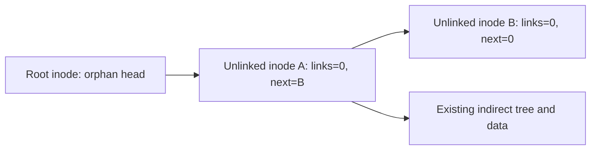

# Persistent cleanup and format compatibility

## Version boundary

Journal anchor version 2 retains the version 1 default log geometry, record
encoding, CRC32C and commit ordering. It adds filesystem cleanup semantics,
optional larger reserved extents and durable transaction receipts. New formats use
version 2; readers continue to accept version 1. There is no automatic upgrade.
Old version 1 readers reject version 2 before mounting. Version 1 mounts keep the
previous EBUSY contract for unlink of the final open link.

## On-disk ownership

The root inode's reserved word at byte 120 (`resv2[0]`) is the orphan-list head.
An orphan file uses that same reserved word as its next inode number. Ordinary
files remain allocated, retain their size and mappings, and have link count zero.
The root cannot be an orphan. Namespace removal, link count change and list
insertion are committed together by the filesystem metadata transaction, without
requiring a user transaction. An explicit user transaction protects the same
changes until its commit; abort restores the prior namespace and descriptors.

An open descriptor retains access through its inode number. The last descriptor
close makes the inode eligible for cleanup. At mount all orphan descriptors have
been lost, so all list members are eligible. Recovery always replays the journal
before traversing the list. List bounds, inode types, zero link counts and loop
limits are checked before cleanup. A bad list fails the mount rather than freeing
an arbitrary live inode.

## Bounded cleanup

Cleanup frees a bounded suffix of one eligible inode per filesystem transaction,
updates the remaining size and checkpoints it before continuing. No user-visible
file can see the decreasing size because cleanup starts only after the last
close. A crash replays the current step and resumes from the retained inode size.
The final step removes the list edge and frees the inode in one transaction.
Live-user-transaction cleanup cannot be split across commits. It is delayed until
the explicit transaction has committed. Failed cleanup retains the list and
requires recovery if persistence is uncertain.

Linked truncate uses a separate visible size and cleanup cursor, as described
below. Sparse mappings, durable user outcome records and asynchronous
checkpointing have separate contracts and regressions in the roadmap suite.

## Linked truncate intent (version 2)

A regular inode with `resv0 & 1` is a linked truncate-cleanup member of the same
list. Its visible size is `i_size`; `i_parent` (unused for regular files) stores
the cleanup high-water mark in blocks. The root-list link is still `resv2[0]`.
Shrink commits visible EOF, partial-tail zeroing, the cursor and list insertion
together. Each later cleanup transaction frees at most a 1 MiB logical suffix,
updates the cursor, and preserves visible EOF. Empty logical ranges are skipped
using the highest remaining mapping, without scanning the hole length.

Cleanup is delayed until an explicit user transaction commits. If that same
transaction grows or writes the inode again, it first clears its pending suffix
within the same transaction, so stale tail mappings cannot become visible. This
may exceed the user budget and make the group abort-only, but never publishes a
partial user transaction. Unlink of an inode already carrying a truncate intent
retains its single list membership. Final cleanup removes the intent; only a
zero-link inode with no remaining open descriptor is freed.
