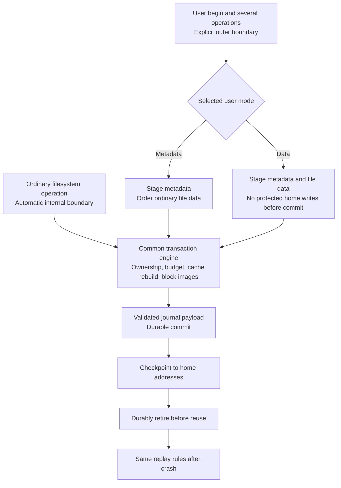

# NVFUSE User Transaction API Design

Date: 2026-11-12

Status: Implemented bounded standalone API, with optional background file-image checkpointing.

NVFUSE must preserve its own metadata consistency without an application transaction API. This API adds an optional application boundary around several filesystem operations. It builds on [metadata journaling](metadata-journaling-design.md); it does not replace or enable the filesystem's ordinary crash protection.

Applications select metadata atomicity or metadata and file-data atomicity at transaction begin. These are different persistence contracts, not different levels of filesystem metadata correctness.

## Two Transaction Boundaries

| Property | Internal filesystem transaction | Explicit user transaction |
| --- | --- | --- |
| Who starts it | The filesystem automatically | The application |
| Boundary | One supported filesystem operation and its nested helpers | Several supported operations |
| API needed for consistency | None | Only for atomic grouping across operations |
| Metadata recovery | Required for normal operations | Required for the entire group |
| Regular-file overwrite atomicity | Not implied by metadata journaling | Optional, selected explicitly |
| Example | Rename removes and adds entries consistently | Create several entries and rename a manifest together |

A successful ordinary operation must never leave filesystem structures inconsistent after recovery. Its return alone need not imply durability unless its API promises a synchronous commit. The initial implementation may conservatively make each successful mutating operation durable; later batching must preserve the distinction between visibility, consistency, and durability.

## Optional Atomicity Modes

### Metadata Mode

`NVFUSE_TX_METADATA` groups namespace, inode, allocation, and other recovery-critical metadata. Commit or recovery applies that metadata as one unit. Abort restores the metadata state.

Regular-file bytes are not rolled back in this mode. If writes are supported inside the transaction, overwrites of existing file data may remain after abort or appear after a crash even when the metadata returns to its previous state. A deleted block reused inside the transaction also needs careful treatment: old file content cannot be promised without data protection. Newly exposed data must still be initialized and ordered before metadata commit.

Directory blocks, directory indexes, indirect blocks, symlink targets, and xattrs are metadata for this contract even when physically stored in the data area.

### Data Mode

`NVFUSE_TX_DATA` includes metadata and regular-file contents. Writes, including existing-data overwrites, remain private until commit. Abort leaves the previous file contents and metadata intact. Recovery applies the complete committed group.

The first implementation uses full-block redo logging for data as well as metadata. Partial writes use read-modify-write images, and repeated changes to the same physical block produce one final image. This reuses the journal verifier and replay engine, at the cost of more log space and write amplification. COW or extent-based data logging is a later alternative, not an assumed optimization.

Data mode does not include external effects such as network messages, other filesystems, memory changes, or device operations. Physical media corruption beyond the validated persistence model is not transaction rollback.

## Public API

Declarations are in [`include/nvfuse_tx.h`](../include/nvfuse_tx.h).

```c
enum nvfuse_tx_mode {
    NVFUSE_TX_METADATA = 1,
    NVFUSE_TX_DATA = 2
};

int nvfuse_tx_begin(struct nvfuse_handle *fs,
                    enum nvfuse_tx_mode mode,
                    unsigned block_budget);
int nvfuse_tx_commit(struct nvfuse_handle *fs);
int nvfuse_tx_abort(struct nvfuse_handle *fs);
int nvfuse_tx_status(struct nvfuse_handle *fs);
```

`block_budget` bounds the number of distinct journaled blocks, including hidden metadata changes. It must fit journal capacity and reserve descriptor, commit, and control overhead. Zero selects the discovered capacity: 4075, 8155 or 16315 distinct protected blocks for 16, 32 or 64 MiB journals. Reject invalid modes or impossible budgets before beginning the transaction.

Existing filesystem APIs join the active transaction on that handle. Helpers inherit the current transaction and cannot create independent durable commits. Without an explicit user transaction, the public filesystem operation obtains an internal boundary automatically.

```c
int rc = nvfuse_tx_begin(fs, NVFUSE_TX_DATA, budget);
if (rc != 0)
    return rc;

/* Create and initialize a replacement, then publish it. */
int fd = nvfuse_openfile_path(fs, "/next", O_CREAT | O_RDWR, 0644);
if (fd < 0) {
    rc = fd;
    goto abort;
}
int written = nvfuse_writefile(fs, fd, bytes, length, 0);
if (written != length) {
    rc = written < 0 ? written : -EIO;
    goto abort;
}
rc = nvfuse_closefile(fs, fd);
if (rc != 0)
    goto abort;
rc = nvfuse_rename_path(fs, "/next", "/current");
if (rc != 0)
    goto abort;
return nvfuse_tx_commit(fs);

abort:
{
    /* Successful abort also invalidates descriptors opened in this TX. */
    int abort_rc = nvfuse_tx_abort(fs);
    return abort_rc != 0 ? abort_rc : rc;
}
```

The fragment assumes negative errno-style results. Preserve both the original operation error and any abort failure in application diagnostics. A successful abort does not turn the failed operation into success.

## Ownership and Visibility

The standalone backend supports one handle, one owner thread and one active user transaction. Nested begin returns `-EBUSY`. Other threads may submit through the bounded queue; filesystem execution stays on the owner. Cache-bypass I/O is synchronous and joins the same overlay. Multiprocess sharing and historical AIO prepare helpers remain unsupported. These limits do not claim general serializable multi-client transactions.

The owner sees its own pending changes. Other access to the volume is excluded by image or device ownership. No external reader may observe partially checkpointed committed metadata. Supporting independent readers later requires snapshots, versioned caches, or a defined lock protocol.

Begin requires no open file descriptors; otherwise it returns `-EBUSY`. Descriptors opened inside the transaction remain valid after successful commit. Abort closes and invalidates them. Reused integer descriptor values do not make an old descriptor valid again; applications must discard aborted descriptors. Abort restores the saved current-directory and process-local root fields.

## Supported Operations

| Operation | Metadata mode | Data mode |
| --- | --- | --- |
| Create, mkdir, rename, link, unlink, rmdir | Atomic metadata group | Atomic metadata group |
| Permissions, ownership, timestamps | Wrapped where available on the platform | Wrapped where available on the platform |
| Inline string xattrs and fallocate | Atomic metadata; allocated data is initialized/ordered | Protected data and metadata |
| Read and lookup | Read own changes | Read own changes |
| Buffered write | Metadata atomic, regular-file bytes not rolled back | Data and metadata atomic |
| Sequential extension and shrinking | Metadata atomic; bytes are not restored | Protected bytes and metadata are restored |
| Sparse writes past EOF and truncate growth (v2) | Holes read zero; metadata atomic | Data and metadata atomic |
| Symlink creation | Target content is protected metadata | Target content is protected metadata |
| `fsync`, `fdatasync`, `sync` inside user TX | Reject with `-EBUSY` | Reject with `-EBUSY` |
| Aligned FS-cache-bypass I/O | Same ordered metadata contract | Same protected DATA overlay |
| Queued submissions | Owner executes grouped metadata requests | Owner executes grouped DATA requests; queue is exclusive with public user TX |

The matrix is an integration checklist, not a claim that all legacy APIs already implement correct failure paths. An operation is supported only after its mutation, error, resource-exhaustion, and recovery paths pass the tests below. Unsupported APIs must fail before changing state.

Rejecting sync inside a user transaction prevents it from committing only part of the group. `nvfuse_tx_commit()` is the durability boundary. Internal ordered-data flushes remain permitted; they must never publish uncommitted metadata, or uncommitted file data in data mode.

## State and Error Contract

```mermaid
stateDiagram-v2
    [*] --> Idle
    Idle --> Active: begin with mode and budget
    Active --> Active: successful operation
    Active --> AbortOnly: operation or budget failure
    Active --> Committing: commit
    Active --> RollingBack: abort
    AbortOnly --> RollingBack: abort or rejected commit
    Committing --> Idle: durable commit; checkpoint may continue
    RollingBack --> Idle: undo and cache restoration complete
    Committing --> RecoveryRequired: persistence outcome uncertain
    RollingBack --> RecoveryRequired: restoration fails
    RecoveryRequired --> [*]: close and recover before further writes
```



Mutation, storage and budget failures make the transaction abort-only. Expected ENOENT, ENOTDIR, ENODATA and ERANGE from read-only lookup/query operations preserve the active transaction. A failed mutation using the same errno still makes the group abort-only; continuing must not accidentally commit partial work.

| Result | Required meaning |
| --- | --- |
| Begin succeeds | A transaction is active with a valid mode, owner and on-disk block budget. Overflow staging can temporarily use additional RAM. |
| Operation succeeds inside TX | The change is visible to the owner; it is not yet durably committed. |
| Commit returns zero | The entire selected metadata/data group is durably committed. Default synchronous mode completes checkpoint and retirement; optional background mode completes them before slot reuse. |
| Abort returns zero | Protected state is restored; aborted descriptors are invalid. Metadata mode may retain ordinary file-data writes. |
| Capacity or mutation failure before commit | The group cannot be committed; restore it through abort. |
| Commit I/O error with uncertain persistence | Do not claim rollback. Stop writes and recover the image to determine the outcome. |

A lost commit response can leave an application uncertain even when recovery preserves a valid committed transaction. Version 2 provides 16-byte application keys and queryable outcomes in a bounded retained receipt page. See [durable outcomes](transaction-outcomes-design.md) for begin/query/forget semantics. Unkeyed applications still must not retry non-idempotent work blindly.

## Shared Journal Architecture



Internal and explicit transactions use the same ownership, cache, log, validation, and recovery machinery. User transactions extend the boundary and select additional data coverage; they must not introduce a parallel durability implementation.

Normal cache pressure may flush staged images into a private transaction store, but cannot write protected blocks to their home locations. Reads must consult pending versions even after cache eviction. Data mode requires the same rule for every regular-file I/O path.

Abort must undo in-memory state as well as discard a log. This includes cached block images, descriptors, free counters, allocator hints, directory indexes, file tables, and any application-visible descriptor state. The reference implementation rebuilds caches from the committed disk state while preserving the public handle identity; this is slower than selective undo. It must not publish pending changes during teardown.

## Capacity and Large Transactions

Reserve resources before mutation where possible. A transaction budget includes B+tree splits, new indirect blocks, group descriptors, bitmaps, and inode-table blocks. The application cannot estimate capacity from its payload length alone.

Do not silently split a user transaction into independently committed pieces. If the group exceeds the supported budget, fail the group and restore protected state. Streaming arbitrarily large data transactions requires a larger or segmented journal, or COW; it cannot be implemented by early home writes to existing protected data.

Large unlink or truncate may require persistent deferred-cleanup intents. Namespace publication and resource reclamation can be separate internal phases only if the user-visible atomicity contract and recovery completion remain correct. Freed blocks must not be reused while an older accepted transaction can replay onto them.

## Recovery Contract

Recovery does not require the application to call begin again. A valid durable commit causes replay of all protected block images for the selected mode. A definitely incomplete transaction leaves the previous protected state in effect. Transaction IDs, volume identity, checksums, and retirement rules prevent stale-slot reuse.

Metadata mode recovery may expose data overwrites that occurred before the metadata commit. Data mode must not. This difference must be visible in the API documentation, examples, test names, and performance reports.

The original journal design covers recovery of internal metadata updates. Adding data mode requires record coverage flags, capacity accounting for payload blocks, verification of regular-file replay targets, and data-mode fault tests. Changing the transaction record format requires a new compatible version or an explicit incompatible feature.

## Current implementation and limits

- The underlying handle has one owner thread. The new bounded submission queue
  accepts producers on multiple threads and executes on that owner. Public begin
  still requires closed descriptors and no live queue; internal queue groups
  snapshot their pre-existing descriptors.
- Automatic filesystem metadata protection works without user begin. Optional
  DATA mode protects regular file bytes; metadata mode does not promise rollback
  of existing ordinary data overwrites.
- New images use version 2; version-1 journals remain readable without upgrade.
  New file images may choose 16/32/64 MiB journals with 4075/8155/16315 distinct
  protected images. Metadata and durable receipts share that budget.
- Impossible DATA payloads fail before mutation; hidden metadata costs can make
  a group abort-only. Preflight reserves classification and bounded overflow
  workspace. Complete credit admission and safe unwind of every legacy path
  remain unqualified; some original cache/mount I/O/allocation paths fail fast.
- Persistent orphan and linked-truncate cleanup continues in bounded transactions
  after commit and resumes on mount. A large pending shrink followed by growth or
  write in the same user group can return E2BIG; no early user commit occurs.
- Sparse write/growth, inline string xattrs, range allocation, cache-coherent direct
  APIs and asynchronous submission queues have dedicated regressions. Historical
  AIO prepare helpers are still rejected. The metadata-only test format rejects
  DATA groups and direct payload I/O.
- Optional file-backend background checkpointing acknowledges durable commit
  certificates, joins before slot reuse and poisons the handle on a later worker
  error. SPDK background checkpointing remains rejected.
- Durable 16-byte keys retain up to 127 outcomes until explicitly forgotten.
  Reusing a retained committed key returns EALREADY. UNKNOWN is meaningful only
  on a healthy handle after recovery. Forget acknowledges loss of retry protection.
- Closing a healthy active TX or live queue returns EBUSY. A poisoned handle closes
  with EIO; reopen replays the durable log. An uncertain commit must never be
  reported as an aborted group.
- [COW is evaluated but not implemented](large-transactions-design.md). There is
  no unlimited streaming user TX, physical multi-queue filesystem execution or
  automatic in-place format conversion.

This contract describes the bounded standalone API. The primary API/SPDK
adapter has a separate ownership and durability contract and does not expose
these optional application transaction features.
